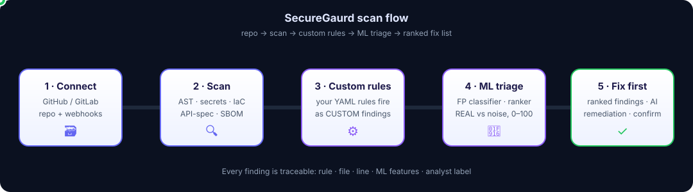
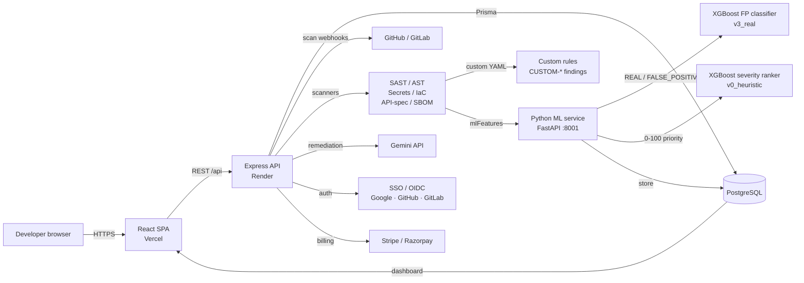

# SecureGaurd

**Application security for code repositories — scan, triage, and fix vulnerabilities with measured, auditable results.**


🌐 **Live app:** https://secureguard-main.vercel.app



## About

SecureGaurd is an application-security platform built by [Rishabh Sharma](https://github.com/r1shabhsharma05). Connect a GitHub or GitLab repository, run a scan, and get a ranked list of real vulnerabilities — SAST, hardcoded secrets, IaC, API-spec and SBOM — triaged by measured ML models so teams fix what matters first, not noise.

🌐 **Live app:** https://secureguard-main.vercel.app

## Overview

SecureGaurd is a multi-tenant application-security platform for software teams. Connect a GitHub or GitLab repository, run a scan, and get a ranked list of real vulnerabilities — not noise.

Most scanners drown teams in findings. SecureGaurd attacks that problem from three sides:

1. **Deep scanning** — AST-based SAST, hardcoded-secret detection, IaC scanning (Terraform, Kubernetes, Docker, CloudFormation), API-spec scanning, and SBOM generation (CycloneDX + SPDX) with NVD enrichment.
2. **Your own rules** — write custom YAML rules for your codebase; they fire as `CUSTOM-*` findings that no ML model can suppress.
3. **Measured ML triage** — an XGBoost false-positive classifier and a severity-priority ranker, both trained and evaluated on a real-findings dataset, so the queue is ordered by what to fix first.

**Who it's for:** engineering teams that want security scanning inside their workflow, security engineers who need auditable results, and solo developers who want a real scanner without enterprise bloat.

## How a scan works

1. **Connect a repository** — GitHub or GitLab, via webhooks or a manual scan trigger. Multi-tenant workspaces keep organizations, repos, and findings isolated.
2. **Scan** — the engine extracts AST features (Babel), runs SAST, secret, IaC, and API-spec rules, and generates an SBOM.
3. **Custom rules fire** — your validated YAML rules run against the same tree. Matches become `CUSTOM-*` findings. A rule that fails to compile is skipped with a log line — one bad rule never fails a scan.
4. **ML triage** — findings with ML features are sent to the Python classifier service (`/classify/batch`): `REAL` stays open, `FALSE_POSITIVE` is auto-ignored. Secrets (`SEC-*`) skip ML entirely and are always kept as `REAL` — fail-safe by design.
5. **Rank** — the severity ranker blends CWE tier, exposure context, and P(REAL) into a 0–100 priority score (`0.6 × severity + 0.4 × P(REAL) × 100`).
6. **Review in the dashboard** — findings in severity or AI-Priority order, with rule, file, line, ML features, and analyst labels. Confirm, ignore, or apply the Gemini-powered AI fix.
7. **Close the loop** — every Confirm/Ignore/Apply Fix writes a label back to the database, feeding the next retraining round.

## Architecture



Scan data flow (detail): trigger → AST feature extraction → enrichment (dismiss history, git churn, rule map) → classifier batch (`/classify/batch`, chunks of 50) → store findings + `mlFeatures` JSON → dashboard → optional AI-Priority re-sort (`/api/v2/ml/rank` → `/v2/rank/batch`).

## What shipped — Phase 2+3 program (24 Oct – 2 Nov 2026)

A 10-day build program delivered the platform end to end:

| Area | What landed |
|---|---|
| Scanning | AST/SAST, secrets, IaC (Terraform / K8s / Docker / CloudFormation), API-spec scanner, SBOM (CycloneDX + SPDX), NVD enrichment |
| Custom rules | Validated YAML rules engine, per-workspace rules, test-scan against the live repo tree, dashboard Rules page |
| ML triage | FP classifier retrained on 222 real findings (`v3_real`, deployed); severity-priority ranker with AI-Priority dashboard toggle |
| Auth & tenancy | SSO/OIDC (Google, GitHub, GitLab) with PKCE, env-gated and fail-closed; organizations, RBAC, invitations, account deletion |
| Platform | On-prem Docker Compose package, Render + Vercel deploy configs, rate limiting, Turnstile + Sentry wiring, backup/restore docs |
| Workflow | GitHub/GitLab scan webhooks, compliance reports (PDF), AI remediation via Gemini, analyst feedback loop for retraining |

## Verified numbers

Every number below is traceable to an artifact in this repo or a recorded live verification — no marketing figures.

| Number | What it is | Source |
|---|---|---|
| **222** | Real findings in the classifier training/eval dataset (38 real / 184 FP) | `backend/services/fp-classifier/datasets/day8/evaluation_report_v3.json` |
| **0.9556 / 1.0** | `v3_real` accuracy on the held-out 45-finding test split (first / second pass) | Same evaluation report |
| **0.9446** | Severity ranker Spearman ρ (held-out); MAE 0.482, R² 0.9898 | `backend/services/severity-ranker/severity_metadata.json` |
| **4 CUSTOM** | Custom-rule findings fired by a live NodeGoat scan (108 files): 3× CUSTOM-001, 1× CUSTOM-002 | Day-10 live verification, 29/29 suite |
| **13/13 · 29/29** | Custom-rules unit suite / live verification suite | `backend/tests/phase2_day10_custom_rules_verify.js` |
| **365** | Tracked files in the repo at `main` | Git tree at HEAD |
| **41** | Files in `backend/tests/` (unit, integration, verification) | Git tree at HEAD |
| **58 / 17** | Frontend components / backend API route modules | Git tree at HEAD |

> Note: `docs/severity-ranker.md` quotes an older ranker evaluation (Spearman 0.9976). The numbers above come from `severity_metadata.json`, the artifact written by the training run itself, and are the authoritative ones.

## Tech stack

| Layer | Technology |
|---|---|
| Frontend | React 19, Vite 8, TypeScript, Tailwind CSS 4, React Router 7, Framer Motion, GSAP, Lucide, Radix UI |
| Backend | Node.js 20+, Express 5, Prisma 7, PostgreSQL (`pg`), Babel parser/traverse (AST), `js-yaml` (custom rules) |
| ML services | Python 3.11+, FastAPI, XGBoost (`XGBClassifier` + `XGBRegressor`), joblib |
| Auth | JWT + refresh tokens, bcryptjs, SSO/OIDC (Google / GitHub / GitLab, PKCE) |
| Platform | Vercel (frontend SPA), Render (Express API), Docker Compose (on-prem), `express-rate-limit`, Helmet |
| Integrations | GitHub/GitLab webhooks, Google Gemini (AI remediation), Stripe + Razorpay (billing), Nodemailer, Cloudflare Turnstile, Sentry |
| Data | PostgreSQL via Prisma; `mlFeatures` JSON stored per finding; analyst labels feed retraining |

## Features

- **Repository scanning** — SAST with AST feature extraction, secrets, IaC, API-spec, SBOM.
- **Custom YAML rules** — team-specific detections that ML can never suppress; test-scan before enabling.
- **False-positive classifier** — XGBoost, trained on real labeled findings, with a feedback loop.
- **Severity ranker** — 0–100 priority blending severity, exploitability context, and P(REAL).
- **Workspaces & RBAC** — organizations, roles, invitations, per-workspace rules and findings.
- **SSO/OIDC** — Google, GitHub, GitLab login with PKCE; fail-closed when not configured.
- **Compliance reports** — PDF reports, CycloneDX/SPDX SBOMs, NVD-enriched findings.
- **AI remediation** — Gemini-suggested fixes, applied only on analyst confirmation.
- **On-prem** — Docker Compose package (`SecureGaurd-main/docker-compose.yml`) for self-hosting.

## Project structure

```text
SecureGaurd/
├── README.md                        # this file
├── docs/
│   └── scan-flow-animated.svg       # animated scan-flow diagram (SMIL)
└── SecureGaurd-main/                # canonical application root
    ├── src/                         # React 19 + Vite frontend (58 components)
    │   ├── components/              # Dashboard, CustomRulesPage, ComplianceReports, …
    │   ├── context/  services/  config/
    ├── backend/                     # Express 5 API + Prisma 7
    │   ├── routes/                  # 17 route modules (scans, repos, ml, billing, …)
    │   ├── utils/                   # securityScanner, astExtractor, customRules, sbom, …
    │   ├── services/
    │   │   ├── fp-classifier/       # FastAPI + XGBoost FP classifier
    │   │   └── severity-ranker/     # FastAPI + XGBoost priority ranker
    │   ├── prisma/                  # schema + migrations
    │   └── tests/                   # 41 files: unit, integration, verification
    ├── docs/                        # readiness, OAuth/SSO, on-prem, backup, ranker docs
    ├── docker-compose.yml           # on-prem package
    ├── render.yaml  vercel.json     # deploy configs
    └── README.md                    # deep technical docs (setup, deploy, verification)
```

## Quickstart

Prerequisites: Node.js 20+, PostgreSQL, Python 3.11+ (only for the classifier service).

```bash
cd SecureGaurd-main
npm install
npm install --prefix backend
cp backend/.env.example backend/.env   # fill with local values; never commit .env
npx prisma generate --schema backend/prisma/schema.prisma
```

Frontend env: copy `.env.example` to `.env.local` and set `VITE_API_URL` to the backend origin. Start in separate terminals:

```bash
npm run dev                  # Vite frontend → http://localhost:5173
npm run dev --prefix backend # Express API → http://localhost:5000
```

`GET http://localhost:5000/health` returns a readiness response. Verify with `npm run lint`, `npm run build`, and `node --test backend/tests/*.test.js`.

**Deploy:** frontend on Vercel with `SecureGaurd-main/` as project root (`VITE_API_URL` → backend URL); backend on Render from `render.yaml` (set `DATABASE_URL`, `JWT_SECRET`, `JWT_REFRESH_SECRET`, `ENCRYPTION_KEY`, `WEBHOOK_SECRET`, `FRONTEND_URL` in the dashboard). Full deployment steps: [`SecureGaurd-main/README.md`](SecureGaurd-main/README.md).

## Current status & known limits

Phase 2+3 is complete (Day 10, 2 Nov 2026), but the following are **not done** — listed here so nobody mistakes the roadmap for reality:

- **Billing (Razorpay) lifecycle is incomplete** — `planPrices` returns null and create-subscription returns 502 on fresh organizations. Test-mode plans exist; the lifecycle is not live.
- **Mobile layout (~390px) is not verified.**
- **On-prem package is statically verified only** — never smoke-tested (no Docker in the build environment).
- **SAML is not built.** SSO is OIDC only.
- **Turnstile and Sentry are inert without keys** — wired in code, not active in production.
- **No backup has been taken and no trial restore has run** — the backup script and docs exist; the drill hasn't.
- **Rate limiting is per-instance in-memory** — a shared-store decision is still open, so the effective limit scales with instance count.
- **Ranker labels are heuristic, not analyst-labeled** (`label_source: heuristic_v0`) — the serving contract is fixed so analyst-labeled weights can drop in later.
- **10 pre-existing ESLint errors** remain in the codebase.

## Docs

- [SecureGaurd-main/README.md](SecureGaurd-main/README.md) — full technical docs: setup, deployment, verification, security checklist.
- [SecureGaurd-main/docs/production-readiness-report.md](SecureGaurd-main/docs/production-readiness-report.md) — readiness review.
- [SecureGaurd-main/docs/OAUTH_SSO.md](SecureGaurd-main/docs/OAUTH_SSO.md) — SSO/OIDC setup.
- [SecureGaurd-main/docs/ON_PREM.md](SecureGaurd-main/docs/ON_PREM.md) — self-hosting.
- [SecureGaurd-main/docs/BACKUP_AND_RESTORE.md](SecureGaurd-main/docs/BACKUP_AND_RESTORE.md) — backup procedure.
- [SecureGaurd-main/docs/severity-ranker.md](SecureGaurd-main/docs/severity-ranker.md) — ranker design and upgrade path.
- [SecureGaurd-main/LIMITATIONS.md](SecureGaurd-main/LIMITATIONS.md) — known ML/AST limitations and mitigations.
- [SecureGaurd-main/project_status.md](SecureGaurd-main/project_status.md) — true final state of the Phase 2+3 program.

## License

No `LICENSE` file is present in this repository yet.
