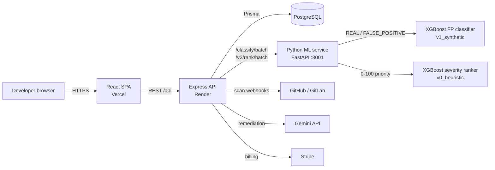
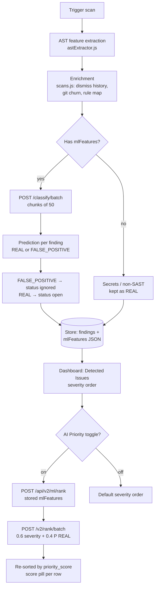

# SecureGuard

SecureGuard is a multi-tenant application for repository security scanning, vulnerability management, compliance reporting, SBOM generation, AI remediation, and billing.

This directory is the canonical application root. The Git repository root contains only the entry-point README and this app directory.

## Architecture

- `src/`: React/Vite frontend
- `backend/`: Express API, Prisma/PostgreSQL access, scanners, integrations, and tests
- `backend/prisma/`: Prisma schema and migration configuration
- `backend/services/fp-classifier/`: optional Python false-positive classifier (FastAPI, XGBoost)
- `backend/services/severity-ranker/`: optional Python severity-priority ranker, served by the same FastAPI service under `/v2/rank`
- `backend/routes/ml.js`: versioned Node proxy (`/api/v2/ml/rank`) for the ranker
- `public/`: frontend assets
- `docs/`: readiness and operational documentation

The frontend and backend are deployed separately. Vercel hosts the static SPA; the Express API is intended for a long-running Node web service such as Render. PostgreSQL and all third-party credentials remain external managed services.

## System architecture



## Scan data flow



## Requirements

- Node.js 20 or newer
- PostgreSQL compatible with the Prisma schema
- Python 3.11 or newer only when using the classifier service
- Provider credentials only for integrations enabled in production

## Local setup

```powershell
npm install
npm install --prefix backend
Copy-Item backend/.env.example backend/.env
npx prisma generate --schema backend/prisma/schema.prisma
```

Fill `backend/.env` with local values. Never commit `.env` files or copy production secrets into the repository.

For the frontend, copy `.env.example` to `.env.local` and set `VITE_API_URL` to the backend origin. Vite exposes only variables prefixed with `VITE_` to browser code; never place secrets in frontend environment files.

Start the services in separate terminals:

```powershell
npm run dev
npm run dev --prefix backend
```

The Vite frontend uses port `5173`; the API uses port `5000`. `GET http://localhost:5000/health` returns a non-sensitive readiness response.

## Frontend deployment: Vercel

Use `SecureGaurd-main/` as the Vercel project root and deploy with the included `vercel.json`.

Set this Vercel environment variable after the backend has a public URL:

```text
VITE_API_URL=https://<backend-host>
```

Then create a production build:

```powershell
npm run lint
npm run build
npx vercel --prod --yes --name secureguard-main
```

## Backend deployment: Render

The included `render.yaml` defines a Node web service with:

- Root directory: `SecureGaurd-main/backend`
- Build command: `npm install && npm run build`
- Start command: `npm start`
- Health check: `/health`

Create the service from the repository Blueprint, then set every `sync: false` variable in the Render dashboard. At minimum, configure `DATABASE_URL`, `JWT_SECRET`, `JWT_REFRESH_SECRET`, `ENCRYPTION_KEY`, `WEBHOOK_SECRET`, and `FRONTEND_URL` with the exact Vercel production URL. Never put these values in GitHub, `render.yaml`, or README files.

After the backend is live, set `VITE_API_URL` in Vercel and redeploy the frontend. Confirm the backend health endpoint and a browser login flow before inviting real users.

## Verification

```powershell
npm run lint
npm run build
node --test backend/tests/*.test.js
npm audit --omit=dev
```

Run database integration and end-to-end scripts only with a disposable test database and test credentials. Never execute Terraform, Kubernetes, Docker, package installation, or repository scripts from scanned repositories.

## Security checklist

- Backend CORS is allowlisted through `FRONTEND_URL` and `FRONTEND_URLS`; it does not accept arbitrary origins.
- Authentication, organization context, RBAC, and tenant filters are the authorization boundary.
- Keep Stripe, GitHub/GitLab, Gemini, database, JWT, encryption, and webhook secrets server-side.
- Rotate any credential that has ever been committed or exposed.
- Review `SECURITY_AUDIT.md`, `LIMITATIONS.md`, and `docs/production-readiness-report.md` before production release.