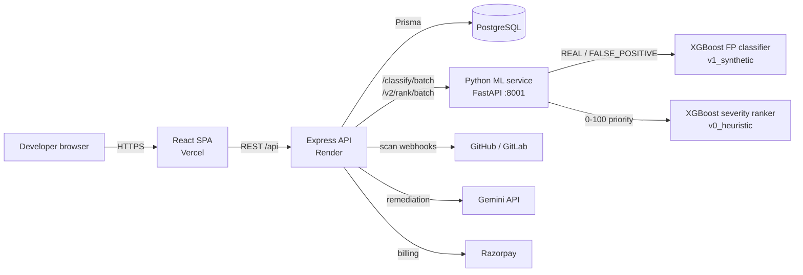
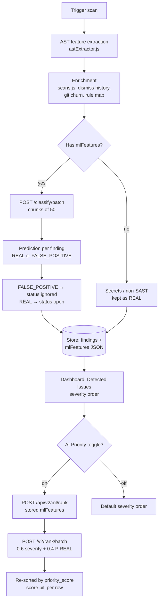

# SecureGuard


SecureGuard is a multi-tenant application for repository security scanning, vulnerability management, compliance reporting, SBOM generation, AI remediation, and billing.

**Live:** app https://secureguard-main.vercel.app · API https://securegaurd.onrender.com

This directory is the canonical application root. The Git repository root contains only the entry-point README and this app directory.

## Architecture

- `src/`: React/Vite frontend
- `backend/`: Express API, Prisma/PostgreSQL access, scanners, integrations, and tests
- `backend/prisma/`: Prisma schema and migration configuration
- `backend/services/fp-classifier/`: optional Python false-positive classifier (FastAPI, XGBoost)
- `backend/services/severity-ranker/`: optional Python severity-priority ranker, served by the same FastAPI service under `/v2/rank`
- `backend/routes/ml.js`: versioned Node proxy (`/api/v2/ml/rank`) for the ranker
- `public/`: frontend assets
- `docs/`: readiness and operational documentation

The frontend and backend are deployed separately. Vercel hosts the static SPA; the Express API is intended for a long-running Node web service such as Render. PostgreSQL and all third-party credentials remain external managed services.

## System architecture



## Scan data flow



## Scan queue & cache

Scans run on a worker, not in the request. `POST /api/scans/trigger`
creates a `queued` scan and returns **202**; a BullMQ worker
(`secureguard-scans`, concurrency `SCAN_WORKER_CONCURRENCY`, default 2)
runs it in a pooled worker thread, then the scan row goes
`queued → running → completed | failed`. With no `REDIS_URL` set the
same FIFO runs in-process and the cache is bypassed — the server boots
either way. Vulnerability lists and terminal scan results are cached in
Redis (60–300 s TTLs, org-scoped, `X-Cache` headers); non-terminal
scans are never cached. See
`docs/SCAN_QUEUE_CACHE_LOADTEST.md` for the design and the measured
numbers: 100 concurrent submissions, submit p95 **6,142 ms → 716 ms**,
cache hit rate **0.95**, 101/101 scans completed, 0 failed. Production
needs `REDIS_URL` set in the Render dashboard (Render Key Value or
Upstash) or it stays on the in-process fallback.

## Requirements

- Node.js 20 or newer
- PostgreSQL compatible with the Prisma schema
- Python 3.11 or newer only when using the classifier service
- Provider credentials only for integrations enabled in production

## Local setup

```powershell
npm install
npm install --prefix backend
Copy-Item backend/.env.example backend/.env
npx prisma generate --schema backend/prisma/schema.prisma
```

Fill `backend/.env` with local values. Never commit `.env` files or copy production secrets into the repository.

For the frontend, copy `.env.example` to `.env.local` and set `VITE_API_URL` to the backend origin. Vite exposes only variables prefixed with `VITE_` to browser code; never place secrets in frontend environment files.

Start the services in separate terminals:

```powershell
npm run dev
npm run dev --prefix backend
```

The Vite frontend uses port `5173`; the API uses port `5000`. `GET http://localhost:5000/health` returns a non-sensitive readiness response.

## Frontend deployment: Vercel

Use `SecureGaurd-main/` as the Vercel project root and deploy with the included `vercel.json`.

Set this Vercel environment variable after the backend has a public URL:

```text
VITE_API_URL=https://<backend-host>
```

Then create a production build:

```powershell
npm run lint
npm run build
npx vercel --prod --yes --name secureguard-main
```

## Backend deployment: Render

The included `render.yaml` defines a Node web service with:

- Root directory: `SecureGaurd-main/backend`
- Build command: `npm install && npm run build`
- Start command: `npm start`
- Health check: `/health`

Create the service from the repository Blueprint, then set every `sync: false` variable in the Render dashboard. At minimum, configure `DATABASE_URL`, `JWT_SECRET`, `JWT_REFRESH_SECRET`, `ENCRYPTION_KEY`, `WEBHOOK_SECRET`, and `FRONTEND_URL` with the exact Vercel production URL. Never put these values in GitHub, `render.yaml`, or README files.

After the backend is live, set `VITE_API_URL` in Vercel and redeploy the frontend. Confirm the backend health endpoint and a browser login flow before inviting real users.

## Verification

```powershell
npm run lint
npm run build
node --test backend/tests/*.test.js
npm audit --omit=dev
```

Run database integration and end-to-end scripts only with a disposable test database and test credentials. Never execute Terraform, Kubernetes, Docker, package installation, or repository scripts from scanned repositories.

## E2E fix batch — 19 Nov 2026

An end-to-end test run (report: `~/workspace/user/files/secureguard-e2e-report-2026-11-19.md`, kept out of the repo) found the app was not genuinely working end to end. The fixes in this batch, all local and unpushed until approved:

- **No more phantom repos.** The dashboard auto-created a repo from the user's first name (`harsh/secureguard-main`, a GitHub 404) whenever the repo list was briefly empty. That effect is deleted. Connect now verifies reachability with `git ls-remote` before storing a URL, and connect failures always surface a toast instead of failing silently.
- **Honest scan states.** A FAILED scan with 0 findings was labelled "Clean Scan"; it now shows "Scan failed" with the failure reason, stored on the scan row (`Scan.errorMessage`, migration `20261119_scan_error_vuln_indexes`). Scan rows are clickable and open a new `/scans/:id` detail page. Trigger Scan asks for confirmation, takes the repo explicitly (no more stale-selection scans), and the trigger/poll fetches time out so the button can never stick on "Scanning…".
- **One definition of "how many findings".** Dashboard, Vuln DB, chart and compliance disagreed because each counted a different slice. Canonical: open findings, distinct by (rule, file, line). `GET /api/vulnerabilities` defaults to `status=open`, returns severity-ranked rows with `?page&limit` and `X-Total-Count`. Re-scans no longer insert duplicate rows (`utils/findingDedup.js`, used by the queued and webhook scan paths). The chart renders real per-day counts instead of hardcoded bars; per-scan counters are labelled "at scan time". Compliance counts `ignored` as resolved instead of dropping it from both sides.
- **SBOM page** falls back to the org-wide list when the per-repo lookup 404s, and shows a real error instead of "No SBOM" when the server fails.
- **AI fix honesty.** The detail page rendered the real engine from `GET /api/ai/status` (rule-based when no Gemini key is set) instead of a hardcoded "Gemini 1.5 Flash" label, and the fix engine's template score is shown separately labelled — never as the finding's CVSS.
- **Billing honesty.** An expired subscription period no longer counts as a paid plan; the billing modal says "Billing not configured" when Razorpay keys/plans are missing (vars documented in `backend/.env.example`). The live Pro row from the old mock checkout ended 19 Nov 2026 and `getOrgPlan` now returns FREE for it, so no manual downgrade is needed.
- **Analytics scope.** The product-activity panel is labelled site-wide (all accounts), restricted to OWNER/ADMIN, and probe/404 paths no longer top "most visited pages".
- **Smaller fixes.** Finding IDs are one format (`V-0068`) everywhere; the Vuln DB has a status filter, AI-priority sort and 25/page pagination; the active tab survives refresh (`?tab=`); the header wraps at ~1034px instead of clipping buttons; `/verify-email` and `/oauth/callback` have correct page titles and the email link auto-verifies on landing; the CI/CD template uses the real webhook URL; Settings can edit the profile name (`PATCH /api/auth/me`) and replay onboarding (`/onboarding?replay=1`).

Regression tests: `backend/tests/e2eFixes.test.js` (10 tests — dedup, compliance ignored bucket, billing expiry, analytics topPaths filter, vuln-list definition, advisory-lock `$executeRaw` regression). Full suite: 107/109 pass; the 2 failures are the pre-existing live-Postgres/secrets ones (`compliance`, `deployment_config`).

**Connect 500 — root cause found in Render logs, fixed here.** Every repo-connect attempt in the E2E window failed with Prisma P2010: `pg_advisory_xact_lock` returns `void`, and Prisma 7's pg adapter cannot deserialize a void column via `$queryRaw`. The lock call in `routes/repos.js` (and the same defect class in `routes/organizations.js` demote/remove/leave paths) now uses `$executeRaw`, which runs the statement without deserializing a result. Regression test above pins all four call sites.

## API keys — 19 Nov 2026

Programmatic access without a password or JWT. OWNER/ADMIN create keys in Settings → API Keys; the full key (`sg_…`) is shown once and never stored — only its sha256 hash. Scopes: `read` (GET findings, scans, SBOMs via the `X-Api-Key` header) and `scan:trigger` (POST `/api/scans/trigger`). Every other method/path with a key is a 403. Keys are org-scoped, revocable (soft revoke, kept for audit), optionally expiring, and die with the creator's org membership. Model `ApiKey` + migration `20261119_api_keys`; management routes `backend/routes/apiKeys.js`; auth in `backend/middleware/apiKeyAuth.js`; tests `backend/tests/apiKeys.test.js` (7 tests). Full suite with this feature: 107/109 pass (same 2 pre-existing env failures).

## Dashboard crash — 19 Nov 2026

After the E2E fix batch shipped, every load of `/dashboard` showed only the error boundary ("Something went wrong") on all tabs, while `/scans/:id` and `/vulnerabilities/:id` rendered fine. The browser could not open DevTools, so a temporary diagnostic build made the error boundary render the error itself: `ReferenceError: Cannot access 'pt' before initialization`. The minified bundle traced `pt` to the Vuln DB filter state — the E2E batch had added `useEffect(() => { setVulnPage(1); }, [filterSev, filterType, filterStatus, searchQuery])` ~200 lines above the `useState` lines declaring those variables. A `useEffect` dependency array is evaluated at render time, so the render read the `const` bindings while they were still in the temporal dead zone and the whole dashboard crashed. The fix deletes the effect entirely: the page reset now lives in the five filter change handlers (severity ×2, type, status, search), which also satisfies the `react-hooks/set-state-in-effect` rule the effect violated. The temporary diagnostic in `ErrorBoundary.tsx` was reverted in the same change. Regression test in `backend/tests/e2eFixes.test.js` (now 11 tests) pins that no `useEffect` dependency is declared after its effect and that all five filter controls reset the page. Full suite with this fix: 108/110 pass (same 2 pre-existing env failures).

## Scan trigger fix — 19 Nov 2026

"Scan Now" and "Trigger Scan" did nothing: 12 clicks across two browser runs created no scan, and the `window.confirm` dialog never appeared. The backend was not at fault — POST `/api/scans/trigger` with an API key queued scan #S-0017, which COMPLETED against the real repo (366 files, 39,979 lines, 6.09 s, 72 findings: 45 critical, 22 high, 5 medium). Root cause: the confirm was a native `window.confirm`, which automated browsers auto-dismiss (the Disconnect button's confirm failed the same way, and it checks the confirm before any token guard), and the old "Scan Now" handler navigated to Overview before confirming, so a dismissed confirm looked like a dead button. Fix: the confirm is now an in-page modal (`scanConfirmRepo` state, same `.modal-overlay` pattern as the connect-repo modal); both entry points open it, and Overview navigation + `triggerScan` run only after the user confirms inside it. `triggerScan` also no longer returns silently: a missing repo toasts, and a missing session refreshes once via `refreshSession()` and toasts if the session is dead. Regression test in `backend/tests/e2eFixes.test.js` (now 12 tests) pins the in-page confirm, the navigate-after-confirm order, and the visible failures. Full suite with this fix: 109/111 pass (same 2 pre-existing env failures). The Disconnect button still uses `window.confirm` and has the same defect; it is a separate fix.

Owner-only status as of 19 Nov 2026: Google + GitHub OAuth client IDs are created and live on Render (the providers endpoint lists both). Razorpay runs on a regenerated test key — the payment flow is verified working in test mode (Upgrade to Pro reaches the Razorpay hosted page); live keys still need the owner to finish Razorpay onboarding (business type + KYC). Brevo has no verified sending domain (no domain is owned; mail goes from verified senders). Done since: phantom repo deleted, real repo r1shabhsharma05/SecureGaurd connected (id 25), first real-repo scan #S-0017 COMPLETED 19 Nov (366 files, 72 findings), finding-row dedupe applied (3 excess rows in scan 8).

## Re-test fix batch — 19 Nov 2026 (afternoon)

An afternoon re-test (HEAD `f1527bf`) confirmed the morning fixes and found the data story still broken. Fixed in this batch (migration `20261119_detected_scans_ai_engine`):

- **Scan detail lists what the scan detected.** A re-scan that deduped everything inserted 0 rows, so `/scans/:id` showed "Findings in this scan (0)" under a 37-finding header. Re-detections now append to `Vulnerability.detectedInScanIds`, and the detail endpoint lists rows by `scanId` OR `detectedInScanIds`. Historical fully-deduped scans (e.g. S-0019) get an honest empty-state message instead of "clean scan".
- **One counts definition, labelled.** The audit log's `findingsCount` counted every detection (open + classifier-suppressed) while scan counters count open only — it now matches the counters, with the raw total kept as `totalDetected`. Dashboard severity cards are labelled "open findings across all repositories"; Files/Time cards now say they come from the most recent completed scan (they were mislabelled "Avg"). The activity chart caption states both definitions. Compliance previews state their scope (one repo, scan date range). Health score is now a severity-mix score (0–100) instead of an absolute-count formula that pinned at 0 for any repo with 7+ criticals.
- **No native `window.confirm` anywhere.** Disconnect, Revoke API key, Delete compliance report, Leave organization, Transfer ownership, and Cancel subscription all use the in-page `ConfirmModal` (native confirms froze tabs / never appeared in automated browsers).
- **AI fix label tells the truth for cached fixes.** The engine that generated a fix is stored (`aiFixEngine`) and returned for cached fixes; legacy cached fixes with no recorded engine show a neutral label instead of claiming the configured Gemini engine.
- **Dedup path normalisation + P2028 resilience.** Paths are compared and stored normalised (wrapper segment stripped), so `SecureGaurd-main/backend/...` and `backend/...` are one finding. RLS transactions wait up to 10 s to start (Prisma's 2 s default threw P2028 under pool contention and failed scans), and the scan worker retries P2028 up to 3 times.
- **SBOM page lists every SBOM.** It used the per-repo endpoint, which returns only the latest SBOM for one repo; it now loads the org-wide list and pre-selects the chosen repo's newest.

Tests: backend suite 119/121 pass (same 2 pre-existing env failures: compliance needs live Postgres, deployment_config needs secrets), including 10 new regressions in `backend/tests/retestFixes.test.js`. Frontend build green; eslint shows only the 9 pre-existing `set-state-in-effect` errors, none in changed code.

## Re-test #2 fix batch — 19 Nov 2026 (evening)

An evening re-test (HEAD `ffad4fa`) verified 6 of the afternoon fixes live and found the rest. Fixed in this batch:

- **AI engine label follows reality.** The Gemini model was hardcoded to `gemini-1.5-flash`, which Google retired — prod logs show `Gemini API error: 404`, so every generation silently fell back to the rule engine while `/api/ai/status` (and the UI badge) kept claiming Gemini. The model now comes from `GEMINI_MODEL` (default `gemini-2.5-flash`), and `/api/ai/status` probes the model endpoint (cached 5 min) and reports the engine that will actually run. The badge/CTA derive the Gemini version from the engine string instead of hardcoding "1.5 Flash".
- **AI status probe exercises generation (follow-up, same evening).** Live verification after the batch showed the production key answers the model-catalog probe but `:generateContent` still returns 404 for it, so the badge could claim Gemini while generation fell back. The probe now runs a 1-token generation (cached 5 min), and generation failures log Google's error body (truncated) instead of the bare status code. Until the production `GEMINI_API_KEY` is replaced with a key whose project can generate, status honestly reports the rule-based engine.
- **Gemini generation actually runs (follow-up, same evening).** The 404's real cause: `gemini-2.5-flash` is closed to new API keys — Google's error body names `gemini-3.8-flash` as the replacement (the code default is now `gemini-3.8-flash`, still overridable via `GEMINI_MODEL`). With a fresh key and the new model, generation then hit the 30 s abort (`This operation was aborted` in prod logs): current Flash models think by default. Generation now sends `thinkingConfig: { thinkingBudget: 0 }`, allows 60 s, and joins all non-thought text parts instead of trusting `parts[0]`.
- **Compliance mapping is CWE-first.** Control mapping OR-ed type in, so nearly every finding mapped to nearly every control (CC6.1 claimed all SAST findings) and per-control evidence counts looked inconsistent. Type is now only a fallback for findings without a CWE; evidence text says "mapped to this control". Report generation also includes findings re-detected by in-range scans (`detectedInScanIds`), not just first-scan dates, and passes the requested date range to the engine (a nested `dateRange` object silently fell back to a default 30-day window).
- **Transaction-start failures are absorbed everywhere.** P2028 "Unable to start a transaction" (free-tier pool contention) now retries inside the RLS context helpers, not just the scan worker — the transaction never began, so retrying cannot double-apply. The two RLS `set_config` calls are one statement (one less round trip per request).
- **Performance: parallel loads, no black pages, warm backend.** The dashboard's five data loads ran sequentially (20–60 s pages); they now run in parallel with per-section failure isolation. Auth guards render a loading screen instead of a black page while the session restores. A GitHub Actions keepalive (`.github/workflows/keepalive.yml`) pings `/health` every 10 min during waking hours so Render's free tier doesn't cold-start (~18 s) on the first visitor.
- **Small honesty fixes.** Vulnerability search matches displayed IDs (`V-0068`, `v-68`, `68`). Settings' "GitHub Integration: Not Connected" is now "GitHub Token: No token saved" with a note that public repos need no token. The members tab shows a loading state (and the fetch retries once) instead of a silent "Members (0)". The SBOM selector selects optimistically (it used to snap back while loading) and shows the SBOM name. The workspace switcher truncates less aggressively.

Tests: backend suite 134/136 pass (same 2 pre-existing env failures), including 15 new regressions in `backend/tests/retest2Fixes.test.js`; `rlsContext.test.js` updated for the single-statement context set. Frontend build green; eslint shows only the 8 pre-existing `set-state-in-effect` errors, none in changed code.

## Security checklist

- Backend CORS is allowlisted through `FRONTEND_URL` and `FRONTEND_URLS`; it does not accept arbitrary origins.
- Authentication, organization context, RBAC, and tenant filters are the authorization boundary.
- Keep Razorpay, GitHub/GitLab, Gemini, database, JWT, encryption, and webhook secrets server-side.
- Rotate any credential that has ever been committed or exposed.
- Review `SECURITY_AUDIT.md`, `LIMITATIONS.md`, and `docs/production-readiness-report.md` before production release.